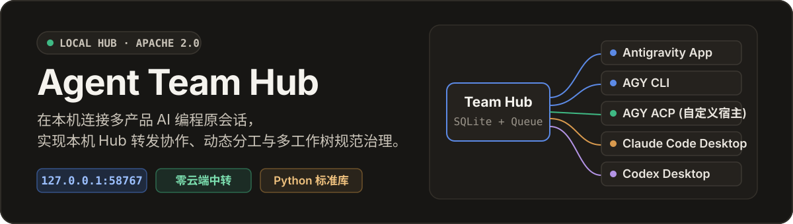
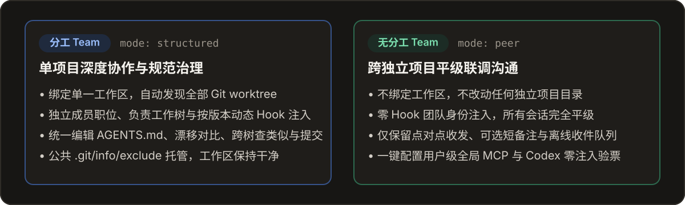
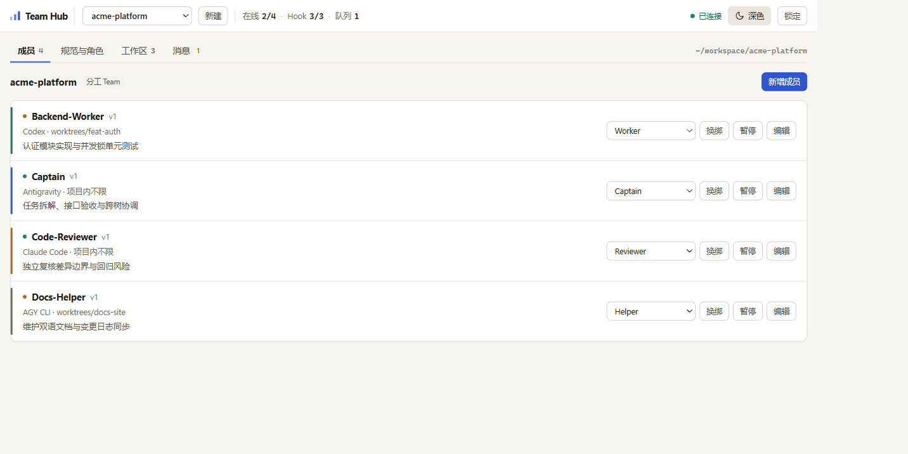
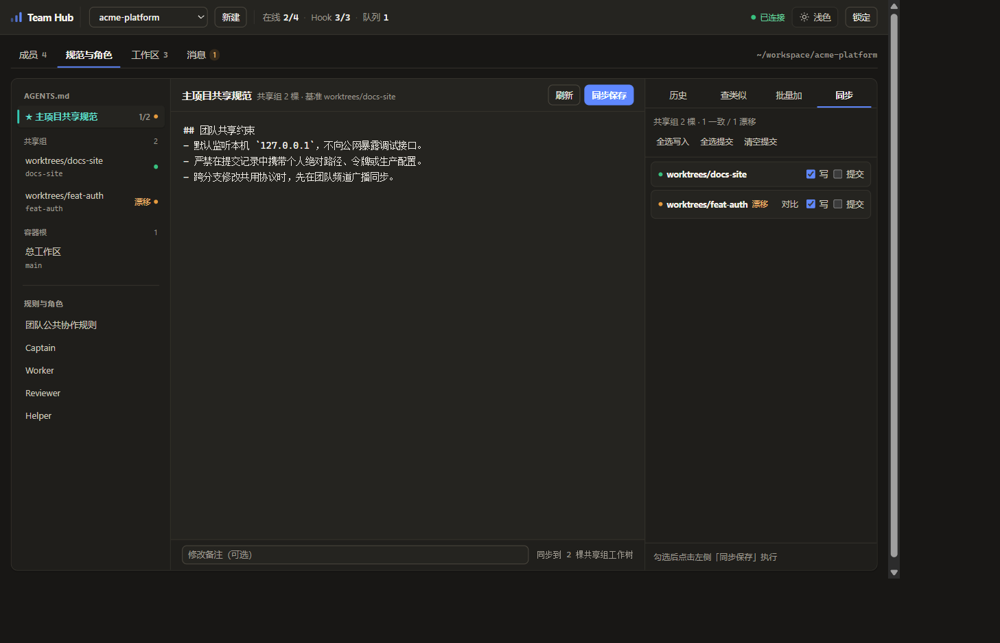
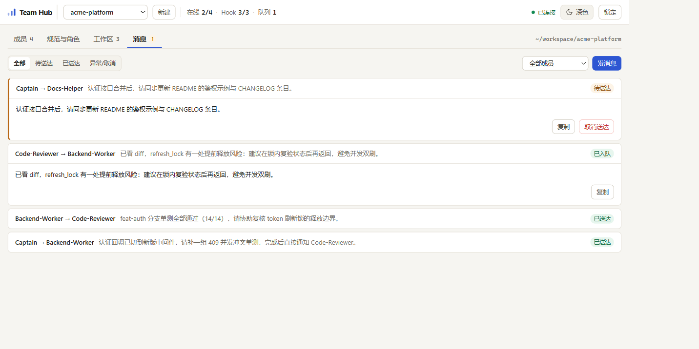

<p align="center">
  
</p>

<p align="center">
  <a href="README.md">简体中文</a> · <strong>English</strong> · <a href="SECURITY.md">Security</a> · <a href="CONTRIBUTING.md">Contributing</a> · <a href="CHANGELOG.md">Changelog</a>
</p>

**Agent Team Hub** is a local-first, zero-cloud multi-agent collaboration router running on `127.0.0.1:58767`. Its core design goal is simple: **connect your existing native Coding Agent sessions directly—without replacing their desktop/CLI clients, switching subscriptions, or losing existing chat history**.

Through a local HTTP/MCP hub and durable SQLite inbox, you can team up native sessions from **Antigravity App**, **AGY CLI**, **AGY ACP (custom local hosts)**, **Claude Code Desktop**, and **Codex Desktop** so they exchange messages inside their native windows, queue offline deliveries, receive mid-turn soft steers, and optionally share dynamic roles plus multi-worktree `AGENTS.md` governance.

<p align="center">
  
</p>

---

## Web Console Preview

> All screenshots below are captured from an isolated, sanitized demo instance (no personal paths, tokens, or third-party agent client UIs).

**Members & Roles (Light theme)** — Monitor online status across native clients, inspect assigned Git worktrees, switch roles inline, and manage session bindings:

<p align="center">
  
</p>

**Docs & Roles Studio (Dark theme)** — Detect `AGENTS.md` drift across multiple Git worktrees, sync shared blocks, search similar rules, and safely commit single files per worktree:

<p align="center">
  
</p>

**Message Queue & Delivery Receipts (Light theme)** — Track queued, accepted (`codex queue` / Hook), and delivered messages with member filtering and cancel support:

<p align="center">
  
</p>

---

## Key Features

- **Native Session Binding & Durable Inbox**: Each member binds to a native session ID. Messages route through the local Hub and persist in SQLite so offline recipients receive them in order upon reconnecting. Codex supports `PostToolUse` / `Stop` Hook mid-turn soft steering (`0.45s` internal single-HTTP timeout, not an end-to-end SLA) with automatic fallback to `codex queue`. Because Codex currently provides no stable per-message delivery correlation ID, both Hook and `codex queue` handoffs are recorded truthfully as `accepted` without heuristic rollout text-matching.
- **Two Team Modes**:
  - **Structured Team (`structured`)**: Bound to a single project workspace with per-member roles (`captain` / `worker` / `reviewer` / `helper` / `reviewer+helper`), assigned worktrees, versioned incremental Hook context injection (skipped silently when unchanged to preserve prompt prefix caching), and a 3-column `AGENTS.md` & role docs studio.
  - **Peer Team (`peer`)**: Workspace-free with zero role injection—all members collaborate as peers across separate repositories with optional short notes and lightweight roster-change reminders.
- **Zero External Backend Dependencies**: The Hub server uses only the Python 3.11+ standard library and local SQLite. The Web Console is pure static ES Modules with zero frontend build step and one-click Light / Dark theme switching.

---

## Quick Start

### 1. Prerequisites & Verified Platforms

- **Python 3.11+** (available in `PATH` or invoked directly)
- **Git** (required only for Structured Team multi-worktree discovery and single-file `AGENTS.md` commits)
- **Node.js 20+** (required only when building the Antigravity plugin `dist/app.html` from source or running frontend syntax checks)
- **Platform Support & CI Matrix**: Full end-to-end live client testing is verified on **Windows 11 + PowerShell 7**. A GitHub Actions CI workflow (`.github/workflows/ci.yml`) is configured for pushes to `main` and PRs targeting `main` across `windows-latest` and `ubuntu-latest`. macOS and Linux can run the core server and standard HTTP/MCP channels (Claude Code Desktop named-pipe push is currently Windows-only; Unix shell scripts passed `sh -n` lint and await full live process-lifecycle testing on macOS/Linux hosts).

### 2. Start the Local Hub

Clone the repository and start the Hub using the script for your environment (first run auto-generates a >= 32-char local `TEAM_HUB_TOKEN`, listening on `127.0.0.1:58767`):

#### Windows (PowerShell 7 recommended)

```powershell
# Start in background / check status / stop (all accept -Port)
.\Start-Hub.ps1
.\Status-Hub.ps1
.\Stop-Hub.ps1

# Open Web Console with local token pre-filled
.\Open-Console.ps1
```

#### Windows (CMD / Double-click wrappers)

Root-level `.cmd` wrappers are provided alongside `.ps1` and automatically delegate to `pwsh` when available (falling back to Windows `powershell`):

```cmd
Start-Hub.cmd
Status-Hub.cmd
Stop-Hub.cmd
Open-Console.cmd
```

#### macOS / Linux (POSIX Shell)

```bash
# Start in background (saves token to .team-hub/.env with chmod 600; supports --port)
./scripts/start-hub.sh

# Check status / stop / open console
./scripts/status-hub.sh
./scripts/stop-hub.sh
./scripts/open-console.sh
```

> **Unix Token Propagation Note**: `start-hub.sh` exports `TEAM_HUB_TOKEN` only to the Hub child process and saves it in `.team-hub/.env`; it cannot inject variables back into your current terminal or already-running GUI apps. Export the same `TEAM_HUB_TOKEN` in your shell profile / desktop session environment and restart clients so MCP tool calls do not return `401`.

#### Manual Foreground Run

**macOS / Linux (POSIX Shell)**:

```bash
export TEAM_HUB_TOKEN="$(python3 -c 'import secrets; print(secrets.token_urlsafe(32))')"
python3 hub.py --workspace ./fixtures
```

**Windows (PowerShell)**:

```powershell
$env:TEAM_HUB_TOKEN = python -c "import secrets; print(secrets.token_urlsafe(32))"
python hub.py --workspace .\fixtures
```

> If you choose a custom port (e.g., `--port 58800` or `-Port 58800`), make sure client MCP/Hook configurations and your `Open-Console` command use the same port.

Open `http://127.0.0.1:58767/manage`, unlock with `TEAM_HUB_TOKEN` (or use the `Open-Console` helper), and follow the onboarding card to create your first Team.

---

## Basic Workflow

1. **Create a Team**: Choose **Structured Team** (bind a project workspace) or **Peer Team** (cross-repository flat collaboration).
2. **Connect Clients**:
   - **Structured Team**: Open the **Workspace** tab and click **Deploy Hooks**. The Hub merges client configs across the root repo and active Git worktrees while adding untracked managed files to `.git/info/exclude`.
   - **Peer Team**: Click **Configure Global Access** at the bottom of the **Members** tab to register user-level Claude/Codex MCP entries and Codex zero-injection verification/inbox hooks without modifying any project repository.
3. **Add Members & Bind Native Sessions**: Click **Add Member**, select the client product, then click **Bind** to get the pairing code or bind snippet. Run it once in the target native chat to start exchanging messages with `team_send`, `team_members`, and `team_whoami`.

> [!IMPORTANT]
> **One-time Codex Hook Approval**: Whether using project-level `.codex/hooks.json` (Structured Team) or user-level `~/.codex/hooks.json` (Peer Team), you **must manually approve/trust the Team Hub hooks once in Codex Desktop Settings → Hooks** after initial deployment. Otherwise Codex will report missing session credentials on `team_send` / `team_members` and mid-turn Hook delivery will not fire.

---

## Client Version Compatibility Matrix

| Client Product | Verified Platform & Build Notes | Cross-Project | Session Recovery | Delivery & Wake Mechanism | Structured Team Context Injection |
| :--- | :--- | :---: | :--- | :--- | :--- |
| **Antigravity App** | Windows 11 (live integration verified; exact build not recorded) | Native | Native conversation ID | Aux Relay side-pane push (keep pane open) | `.agents/hooks.json` (`PreInvocation`) |
| **AGY CLI** | Windows 11 (live integration verified; exact build not recorded) | Native | `team_cli_restore()` | Background `wait-inbox` wakeup + Hook fallback | `.agents/hooks.json` (`PreInvocation`) |
| **AGY ACP (Custom Host)** | Windows 11 (Custom ACP Host Protocol v1 isolated tests + integration) | Native | Persistent `session_id` + `instance` | Host batch `/acp/poll` idle injection | Incremental `/acp/context` by revision |
| **Claude Code Desktop** | Windows 11 (live integration verified; exact build not recorded) | User-level MCP | `CLAUDE_CODE_SESSION_ID` | Windows named pipe push (experimental) | `.claude/settings.local.json` (`UserPromptSubmit`) |
| **Codex Desktop** | Windows 11 · Codex Desktop `26.1120.6357.0` / `codex-cli 0.164.0` (sandbox Hook tests + isolated unit tests passed; live post-snapshot session check pending) | User-level MCP + Hooks | Persistent native thread ID | `PostToolUse` / `Stop` Hook mid-turn soft steer (primary) + `codex queue` idle fallback (requires Hook approval) | `.codex/hooks.json` (`UserPromptSubmit`, `schema v5`) |

> **Why is the Antigravity plugin directory named `mcp-aux-relay-plugin`?** Antigravity App and AGY CLI share a single plugin installed at `~/.gemini/config/plugins/mcp-aux-relay-plugin`. It retains its original package/directory name to preserve seamless in-place upgrades and side-pane plugin identity for existing users.

---

## One-Click Setup Prompts (Paste Into Each Client's Agent)

After cloning this repository, replace `<ABS_REPO_PATH>` with your local absolute path and send the relevant prompt directly to that client's agent.

<details open>
<summary><strong>1. Antigravity App / AGY CLI (Shared plugin — install or upgrade)</strong></summary>

```text
Please install or upgrade the local Agent Team Hub plugin for Antigravity (shared by Antigravity App and AGY CLI under the historical plugin directory name mcp-aux-relay-plugin):
1. Verify that the user-level environment variable TEAM_HUB_TOKEN exists (length >= 32). If missing, ask me to run <ABS_REPO_PATH>/Start-Hub.ps1 (or Start-Hub.cmd / scripts/start-hub.sh) first.
2. Resolve my absolute user home directory <ABS_HOME_DIR> first (do not pass a literal quoted "~" path to Python). The target plugin directory is <ABS_HOME_DIR>/.gemini/config/plugins/mcp-aux-relay-plugin.
3. Verify Node.js >= 20, then run `npm ci` inside <ABS_REPO_PATH>/integrations/antigravity/package/app_build.
4. Build the staged candidate directory at <ABS_REPO_PATH>/.team-hub/ag-candidate, explicitly passing `--dependencies "<ABS_REPO_PATH>/integrations/antigravity/package/app_build"`:
   - First-time install (target plugin directory does not exist yet):
     Run `python "<ABS_REPO_PATH>/integrations/antigravity/stage.py" "<ABS_REPO_PATH>/integrations/antigravity/package" "<ABS_REPO_PATH>/.team-hub/ag-candidate" --dependencies "<ABS_REPO_PATH>/integrations/antigravity/package/app_build"`
     Copy the candidate directory to <ABS_HOME_DIR>/.gemini/config/plugins/mcp-aux-relay-plugin and ensure the Python command in mcp_config.json is executable.
   - Upgrading an existing install:
     Run `python "<ABS_REPO_PATH>/integrations/antigravity/stage.py" "<ABS_HOME_DIR>/.gemini/config/plugins/mcp-aux-relay-plugin" "<ABS_REPO_PATH>/.team-hub/ag-candidate" --dependencies "<ABS_REPO_PATH>/integrations/antigravity/package/app_build"`
     Run `python "<ABS_REPO_PATH>/integrations/antigravity/install.py" "<ABS_REPO_PATH>/.team-hub/ag-candidate" "<ABS_HOME_DIR>/.gemini/config/plugins/mcp-aux-relay-plugin" "<ABS_REPO_PATH>/.team-hub/ag-backup-<TIMESTAMP>"` (using a fresh backup directory name).
5. Remind me to enable or restart the `relay` MCP server in Antigravity Customizations → Installed (for AGY CLI, restart the CLI session).
```

</details>

<details>
<summary><strong>2. Claude Code Desktop (Cross-project global MCP)</strong></summary>

```text
Please configure cross-project global MCP access for Claude Code Desktop to connect to my local Agent Team Hub (MCP tools only, no global hooks):
1. Verify TEAM_HUB_TOKEN exists in user environment variables.
2. Preferred method: open Team Hub Web Console on a Peer Team and click "Configure Global Access".
   If configuring manually, back up ~/.claude.json first, then merge a "team-hub" stdio server into top-level mcpServers (preserving existing servers):
   - type: "stdio"
   - command: absolute path to local Python 3.11+ executable
   - args: ["<ABS_REPO_PATH>/probes/desktop_inbox.py", "58767"]
3. Remind me to restart Claude Code Desktop and run the bind_team_member(...) snippet from the Web Console inside my target chat.
```

</details>

<details>
<summary><strong>3. Codex Desktop (Cross-project global MCP + verification & mid-turn inbox hooks)</strong></summary>

```text
Please configure cross-project global access for Codex Desktop to connect to my local Agent Team Hub (MCP + PreToolUse/PostToolUse/Stop hooks, zero team identity injection):
1. Verify TEAM_HUB_TOKEN exists and that `codex queue` is available in my local Codex CLI.
2. Preferred method: click "Configure Global Access" on a Peer Team page in the Team Hub Web Console to automatically merge ~/.codex/config.toml and ~/.codex/hooks.json.
   If configuring manually, back up both files first and follow the managed block format in <ABS_REPO_PATH>/server/global_access.py:
   - ~/.codex/config.toml: add [mcp_servers.team_hub] pointing to <ABS_REPO_PATH>/project_agent.py mcp 58767
   - ~/.codex/hooks.json: merge PreToolUse (ticket check), PostToolUse, and Stop (mid-turn inbox soft steer) hooks without adding SessionStart or UserPromptSubmit.
3. Remind me to restart Codex Desktop and manually approve/trust the Team Hub hooks once in Codex Settings → Hooks.
```

</details>

<details>
<summary><strong>4. AGY ACP (Custom local ACP host integration)</strong></summary>

```text
Please integrate my custom local ACP host with Agent Team Hub (http://127.0.0.1:58767, Authorization: Bearer TEAM_HUB_TOKEN):
1. Read the `handle_acp_request` handler in <ABS_REPO_PATH>/server/routes_clients.py (dispatched by hub.py) and connect:
   - POST /acp/bind: send persistent session_id, instance, and the 10-char console pairing code (plus optional label); persist the returned route and dynamic mcp descriptor.
   - POST /acp/restore: restore an existing session_id + instance on startup and refresh the mcp descriptor.
   - POST /acp/poll: poll queued messages and refresh heartbeats for a single route or batch of up to 50 routes.
   - POST /acp/received: acknowledge delivery after injecting a message into the session.
   - POST /acp/unbind: cleanly disconnect a session.
   - POST /acp/context: fetch incremental role context for Structured Teams (mode === "structured").
2. Mount the returned `mcp` descriptor directly into the ACP session's `mcpServers` without hardcoding local Hub paths.
```

</details>

---

## Security Boundary & Uninstall

For the complete threat model, list of managed local files, and full uninstall instructions, see **[SECURITY.md](SECURITY.md)**. Key highlights:

- **Localhost Trust Boundary**: The Hub binds strictly to `127.0.0.1` (default port `58767`) and requires `Authorization: Bearer <TEAM_HUB_TOKEN>` on all endpoints except `/health` and static console assets. `TEAM_HUB_TOKEN` is a single-user local full-trust boundary (not multi-tenant).
- **Legacy Plugin Port Disabled by Default**: The Antigravity plugin's legacy helper HTTP port (`58766`) is off by default and only listens on `127.0.0.1` when `RELAY_ENABLE_LEGACY_HTTP=1` is explicitly set, enforcing Bearer auth and a 64 KiB body limit.
- **Plaintext Local SQLite**: Teams, bindings, document revisions, and message queues are stored in plaintext inside `.team-hub/team.db`. Never commit `.team-hub/`.
- **Experimental Local Integrations**: Client-specific local hooks, named pipes, and rollout file paths rely on current client behavior and may require updates when upstream desktop clients change.

---

## Development & Testing

See **[CONTRIBUTING.md](CONTRIBUTING.md)** for repository architecture, zero-dependency conventions, and PR guidelines. A GitHub Actions CI workflow (`.github/workflows/ci.yml`) is configured for pushes to `main` and pull requests targeting `main` across `windows-latest` and `ubuntu-latest`:

```bash
# Run the full isolated unit test suite (uses temp SQLite DBs & ephemeral loopback ports)
python -m unittest discover -s tests -v

# Syntax-check every Console ES Module file individually (node --check ignores extra file args)
for f in console/console.js console/modules/*.js; do node --check "$f" || exit 1; done
```

---

## License & Trademarks

Licensed under the **[Apache License 2.0](LICENSE)** (see [NOTICE](NOTICE)). This repository distributes source code and lockfiles only, without prebuilt third-party bundles.

Antigravity, Claude Code, Codex, and related product names are trademarks of their respective owners (Google, Anthropic, OpenAI, etc.). This project is an independent community tool with no official affiliation or endorsement.
