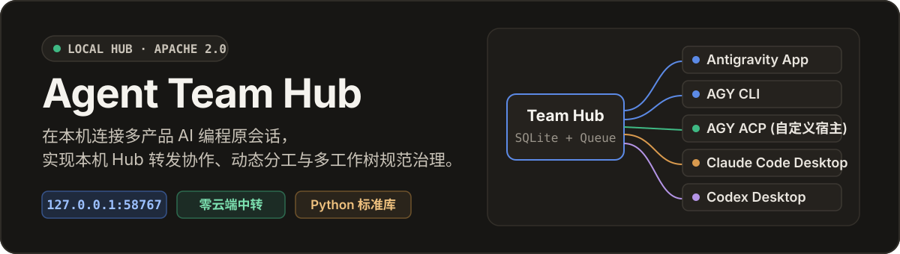
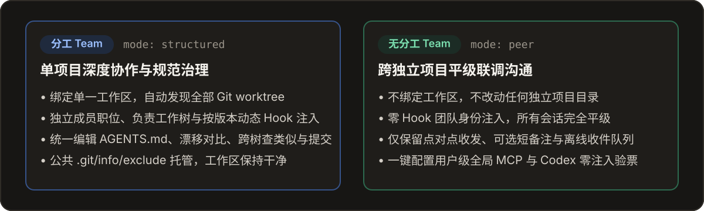
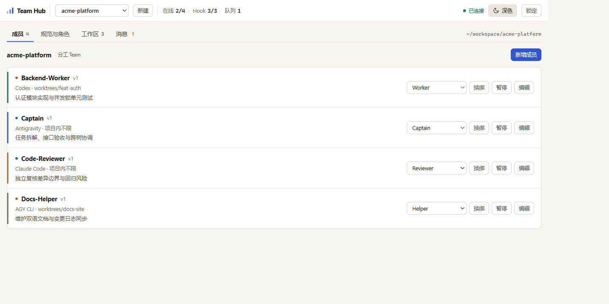
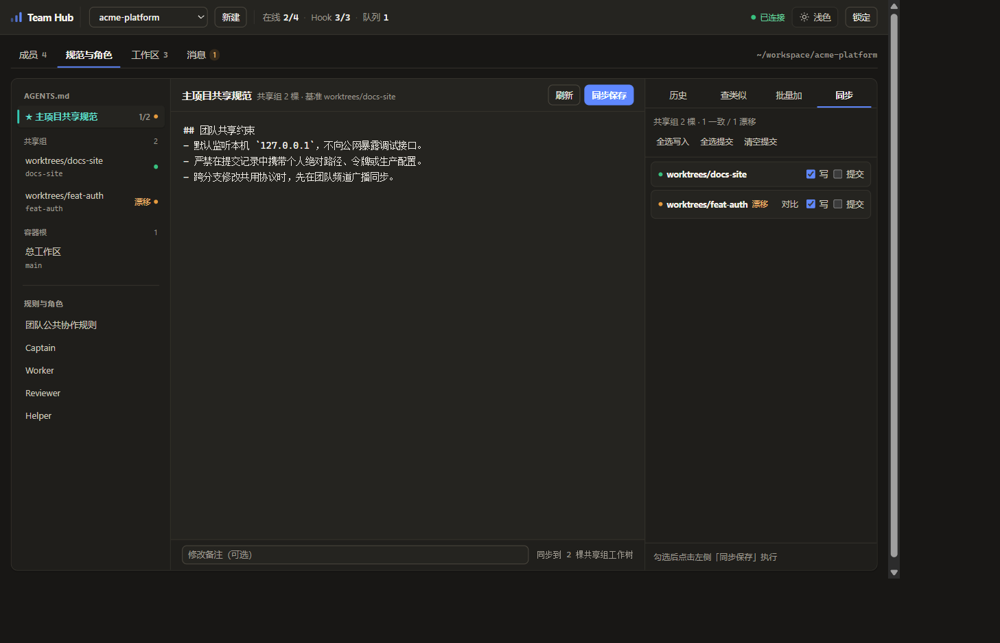
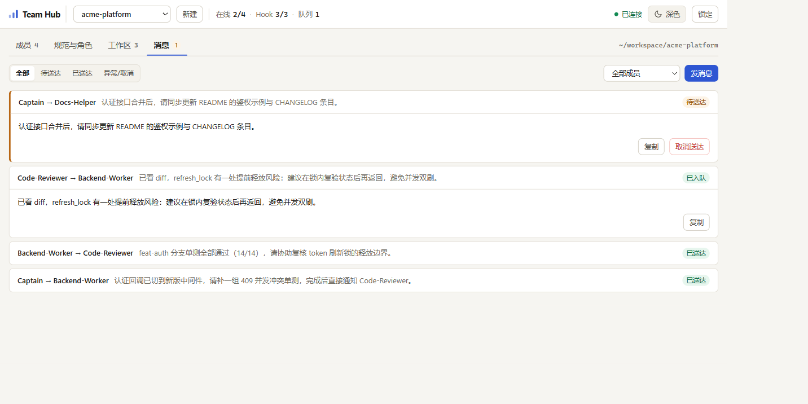

<p align="center">
  
</p>

<p align="center">
  <strong>简体中文</strong> · <a href="README.en.md">English</a> · <a href="SECURITY.md">安全说明</a> · <a href="CONTRIBUTING.md">参与贡献</a> · <a href="CHANGELOG.md">变更日志</a>
</p>

**Agent Team Hub** 是一个运行在本机（默认 `127.0.0.1:58767`）的零云端中转多 Agent 协作中心。它的核心定位是**直接连接你已有的原生 Coding Agent 会话，不替换原客户端、不迁移订阅额度，也不打断现有聊天历史**。

通过本机 Hub 路由与持久队列，你可以将 **Antigravity App**、**AGY CLI**、**AGY ACP（自定义本地宿主）**、**Claude Code Desktop** 与 **Codex Desktop** 的原生会话组成协作团队，在各自原生窗口中互发消息、离线排队收件、同轮软引导，并按需启用动态角色分工与多工作树 `AGENTS.md` 规范治理。

<p align="center">
  
</p>

---

## 管理台实机预览

> 以下截图均来自隔离演示环境，已脱敏处理（不含任何个人路径、令牌或 Agent 客户端界面）。

**成员与分工（浅色暖纸主题）** — 查看多产品原生会话在线状态、负责工作树、实时切换职位与绑定管理：

<p align="center">
  
</p>

**规范与角色工作台（深色石墨主题）** — 多 Git worktree 共享规范漂移检测、跨树同步写入与按树单文件安全提交：

<p align="center">
  
</p>

**消息队列与投递回执（浅色暖纸主题）** — 追踪待送达、已入队（Codex Queue / Hook）与已送达消息，支持撤回队列消息与按成员筛选：

<p align="center">
  
</p>

---

## 核心特性

- **原生会话接入与持久收件队列**：每个成员绑定一条原生会话标识，消息经本机 Hub 转发并持久化在本地 SQLite 队列，离线消息安全暂存、重连后按序送达并记录回执。Codex 支持 `PostToolUse` / `Stop` Hook 同轮软引导（单次内部 HTTP 查询超时 0.45s，非端到端 SLA）与 `codex queue` 空闲排队双通道；由于当前 Codex 宿主无稳定消息关联回执，Hook 与 `codex queue` 交接均如实记录为 `accepted`（`已入队`，不做基于文本的启发式误判升级）。
- **两类团队模式**：
  - **分工 Team (`structured`)**：绑定单一项目工作区，支持成员独立职位（`captain` / `worker` / `reviewer` / `helper` / `reviewer+helper`）、负责工作树、按版本增量 Hook 注入（版本未变时静默跳过以保护前缀缓存），以及三栏式 `AGENTS.md` 与角色规范工作台（漂移对比、跨树查类似替换/移除、批量添加、按树单文件安全提交）。
  - **无分工 Team (`peer`)**：不绑定工作区、零团队身份注入，所有成员平级沟通，仅保留可选短备注与成员变动轻提醒，适合多个独立项目联合开发。
- **零外部后端依赖**：服务端完全基于 Python 3.11+ 标准库与本机 SQLite，管理台为原生 ES Modules 静态网页（零前端构建步骤，内置浅色暖纸 / 深色石墨一键切换）。

---

## 快速部署

### 1. 环境要求与已验证平台

- **Python 3.11+**（需已加入系统 `PATH`，或使用自定义解释器启动）
- **Git**（仅「分工 Team」多工作树发现与单文件提交需要）
- **Node.js 20+**（仅在从源码构建 Antigravity 插件 `dist/app.html` 或运行前端语法检查时需要）
- **已验证平台与 CI 配置**：完整实机端到端验证在 **Windows 11 + PowerShell 7** 下完成；仓库已配置 GitHub Actions 工作流（`.github/workflows/ci.yml`，在 `main` 分支 push 与目标为 `main` 的 PR 触发，矩阵覆盖 `windows-latest` 与 `ubuntu-latest`）。macOS / Linux 可运行核心服务端与通用 HTTP/MCP 通道（Claude Code Desktop 命名管道推送目前仅面向 Windows 桌面端；Unix Shell 启停脚本已完成 `sh -n` 静态检查，尚未在真实 macOS/Linux 主机执行全生命周期实测）。

### 2. 启动本机 Team Hub

克隆仓库后，按你的系统选择对应的启停方式（首次启动会自动生成长度 >= 32 位的本机 `TEAM_HUB_TOKEN`，默认监听 `127.0.0.1:58767`）：

#### Windows（PowerShell 7 推荐）

```powershell
# 一键后台启动 / 查看状态 / 停止服务（均支持自定义 -Port）
.\Start-Hub.ps1
.\Status-Hub.ps1
.\Stop-Hub.ps1

# 自动携带本机令牌打开管理台
.\Open-Console.ps1
```

#### Windows（CMD 命令提示符 / 直接双击）

仓库根目录同时提供 `.cmd` 封装脚本，会自动优先调用 `pwsh`（PowerShell 7），未安装时回退至系统自带 `powershell`：

```cmd
Start-Hub.cmd
Status-Hub.cmd
Stop-Hub.cmd
Open-Console.cmd
```

#### macOS / Linux（POSIX Shell）

```bash
# 一键后台启动（令牌保存在 .team-hub/.env，权限 600，支持 --port 指定端口）
./scripts/start-hub.sh

# 查看运行状态 / 停止服务 / 打开管理台
./scripts/status-hub.sh
./scripts/stop-hub.sh
./scripts/open-console.sh
```

> **Unix 环境变量传递说明**：`start-hub.sh` 只会把令牌导出给 Hub 子进程并保存到 `.team-hub/.env`，无法反向写入你当前终端或已启动的桌面 GUI 客户端环境。首次生成后，请将同一 `TEAM_HUB_TOKEN` 导出到你的 shell profile / 桌面启动环境并重启各客户端，否则客户端 MCP 工具调用会返回 `401`。

#### 手动前台启动

**macOS / Linux (POSIX Shell)**：

```bash
export TEAM_HUB_TOKEN="$(python3 -c 'import secrets; print(secrets.token_urlsafe(32))')"
python3 hub.py --workspace ./fixtures
```

**Windows (PowerShell)**：

```powershell
$env:TEAM_HUB_TOKEN = python -c "import secrets; print(secrets.token_urlsafe(32))"
python hub.py --workspace .\fixtures
```

> 如使用自定义端口（例如 `--port 58800` 或 `-Port 58800`），请确保各客户端 MCP / Hook 配置与打开管理台时使用同一端口。

启动后访问 `http://127.0.0.1:58767/manage`，粘贴 `TEAM_HUB_TOKEN` 解锁（或直接运行 `Open-Console` 脚本自动带令牌解锁），按首启引导创建第一个 Team。

---

## 简短使用方式

1. **创建 Team**：首次解锁后选择「创建分工 Team」（指定项目总工作区路径）或「创建无分工 Team」（无需路径，跨项目平级联调）。
2. **接入客户端**：
   - **分工 Team**：进入「工作区」页点击 **部署 Hook**，Hub 会自动向总工作区及全部 Git worktree 合并写入客户端配置，并通过 `.git/info/exclude` 忽略未跟踪托管文件（非 Git 目录、已被 Git 追踪的文件或只读目录需手动处理）。
   - **无分工 Team**：在「成员」页底部点击 **配置全局接入**，一键写入用户级 Claude / Codex MCP 与 Codex 零注入验票/收件钩子（不改动任何独立项目目录）。
3. **新增成员并绑定原会话**：点击 **新增成员**，选择对应的客户端产品，保存后点 **绑定** 获取配对码或绑定指引，在目标原聊天完成一次绑定即可开始用 `team_send`、`team_members`、`team_whoami` 互发消息。

> [!IMPORTANT]
> **Codex Hook 手动审批提醒**：无论是分工 Team 的项目级 `.codex/hooks.json`，还是无分工 Team 的用户级 `~/.codex/hooks.json`，在首次部署完成后，**必须在 Codex Desktop 设置（Hooks / 钩子管理）中手动审批（信任）一次对应的 Team Hub 钩子**，否则 Codex 调用 `team_send` / `team_members` 时会提示未获取会话凭据，且同轮 Hook 收件不会生效。

---

## 客户端版本兼容矩阵

| 客户端产品 | 已验证平台与版本记录 | 跨项目支持 | 身份恢复方式 | 收件唤醒机制与前置条件 | 分工 Team 角色注入 |
| :--- | :--- | :---: | :--- | :--- | :--- |
| **Antigravity App** | Windows 11（实机联调已验证，未记录具体 build 号） | 原生支持 | 原生聊天 ID 自动恢复 | Aux Relay 侧栏推送（需打开侧栏） | `.agents/hooks.json` (`PreInvocation`) |
| **AGY CLI** | Windows 11（实机联调已验证，未记录具体 build 号） | 原生支持 | `team_cli_restore()` 自动恢复 | 后台 `wait-inbox` 任务唤醒 + Hook 兜底 | `.agents/hooks.json` (`PreInvocation`) |
| **AGY ACP (自定义宿主)** | Windows 11（自定义 ACP 宿主协议 v1 隔离测试 + 联调） | 原生支持 | 持久 `session_id` + `instance` 恢复 | 宿主批量 `/acp/poll` 空闲注入 | `/acp/context` 按版本增量注入 |
| **Claude Code Desktop** | Windows 11（实机联调已验证，未记录具体 build 号） | 用户级全局 MCP | `CLAUDE_CODE_SESSION_ID` 自动恢复 | Windows 命名管道推送（实验性本地集成） | `.claude/settings.local.json` (`UserPromptSubmit`) |
| **Codex Desktop** | Windows 11 · Codex Desktop `26.1120.6357.0` / `codex-cli 0.164.0`（沙箱 Hook 实测 + 隔离单测通过；本快照发布后待生产原会话复测） | 用户级全局 MCP + Hook | 原生线程 ID 持久绑定 | `PostToolUse` / `Stop` Hook 同轮软引导（优先）+ `codex queue` 空闲排队回退（需审批 Hook） | `.codex/hooks.json` (`UserPromptSubmit`, `schema v5`) |

> **关于历史目录名 `mcp-aux-relay-plugin`**：Antigravity App 与 AGY CLI 共用的插件安装目录沿用了早期开发时的包名 `mcp-aux-relay-plugin`（位于 `~/.gemini/config/plugins/mcp-aux-relay-plugin`），以保证已有用户的平滑升级与侧栏插件 ID 兼容；其实际功能就是 Agent Team Hub 的 Antigravity 本地消息中继插件。

---

## 一键安装 Prompt（直接发给对应产品的 Agent）

克隆本仓库后，把下方对应产品的提示词中的 `<仓库绝对路径>` 替换为你的本机路径，直接发送给该产品的 Agent 即可自动完成安装或接入准备。

<details open>
<summary><strong>1. Antigravity App / AGY CLI（共用同一份插件，含首次安装与升级）</strong></summary>

```text
请帮我安装或升级本机 Agent Team Hub 的 Antigravity 插件（Antigravity App 与 AGY CLI 共用同一份插件，目录名保持历史兼容名 mcp-aux-relay-plugin，无需重复安装）：
1. 确认用户级环境变量 TEAM_HUB_TOKEN 已存在（长度 >= 32 位）；如缺失请提醒我先运行 <仓库绝对路径>/Start-Hub.ps1（或 Start-Hub.cmd / scripts/start-hub.sh）自动生成。
2. 先解析我当前用户主目录的绝对路径 <用户主目录绝对路径>（不要把未展开的 "~" 直接放进引号参数传给 Python），目标插件目录为 <用户主目录绝对路径>/.gemini/config/plugins/mcp-aux-relay-plugin。
3. 确认本机 Node.js 版本 >= 20，进入 <仓库绝对路径>/integrations/antigravity/package/app_build 运行 npm ci。
4. 使用 Python 构建候选目录（输出到 <仓库绝对路径>/.team-hub/ag-candidate），并显式传入 --dependencies 指向刚才 npm ci 完成的 app_build 目录：
   - 如果是首次全新安装（目标插件目录尚不存在）：
     先运行 python "<仓库绝对路径>/integrations/antigravity/stage.py" "<仓库绝对路径>/integrations/antigravity/package" "<仓库绝对路径>/.team-hub/ag-candidate" --dependencies "<仓库绝对路径>/integrations/antigravity/package/app_build"
     然后将生成的候选目录完整复制到 <用户主目录绝对路径>/.gemini/config/plugins/mcp-aux-relay-plugin，并确保其中 mcp_config.json 的 Python 命令在本机可执行。
   - 如果是升级已有安装：
     先运行 python "<仓库绝对路径>/integrations/antigravity/stage.py" "<用户主目录绝对路径>/.gemini/config/plugins/mcp-aux-relay-plugin" "<仓库绝对路径>/.team-hub/ag-candidate" --dependencies "<仓库绝对路径>/integrations/antigravity/package/app_build"
     再运行 python "<仓库绝对路径>/integrations/antigravity/install.py" "<仓库绝对路径>/.team-hub/ag-candidate" "<用户主目录绝对路径>/.gemini/config/plugins/mcp-aux-relay-plugin" "<仓库绝对路径>/.team-hub/ag-backup-<时间戳>" 完成备份与覆盖（每次使用新的备份目录名）。
5. 完成后提醒我在 Antigravity 的 Customizations → Installed 中启用或重启 relay MCP 服务（AGY CLI 重启会话即可生效）。
```

</details>

<details>
<summary><strong>2. Claude Code Desktop（支持跨项目全局 MCP 接入）</strong></summary>

```text
请帮我为本机 Claude Code Desktop 配置 Agent Team Hub 跨项目全局 MCP（仅添加 MCP 工具，不注入任何全局 Hook）：
1. 确认用户级环境变量 TEAM_HUB_TOKEN 已存在（与 Team Hub 使用的令牌一致）；如缺失请提醒我先运行 <仓库绝对路径>/Start-Hub.ps1 自动生成。
2. 优先方式：直接在 Team Hub 管理台的无分工 Team 页面点击「配置全局接入」。
   如需手动配置，请先安全备份 ~/.claude.json，再在顶层 mcpServers 中合并添加名为 "team-hub" 的 stdio MCP 配置（保留已有其他服务）：
   - type: "stdio"
   - command: 本机 Python 3.11+ 可执行文件绝对路径
   - args: ["<仓库绝对路径>/probes/desktop_inbox.py", "58767"]
3. 完成后提醒我重启 Claude Code Desktop，并在目标原会话中执行管理台生成的 bind_team_member(...) 绑定指令。
```

</details>

<details>
<summary><strong>3. Codex Desktop（支持跨项目全局 MCP + 零注入验票与同轮收件钩子）</strong></summary>

```text
请帮我为本机 Codex Desktop 配置 Agent Team Hub 跨项目全局接入（仅提供通信 MCP 与 PreToolUse/PostToolUse/Stop 钩子，不注入团队身份）：
1. 确认用户级环境变量 TEAM_HUB_TOKEN 已存在，且本机已安装支持 `codex queue` 命令的 Codex CLI。
2. 优先方式（推荐）：直接在 Team Hub 管理台的无分工 Team 页面点击「配置全局接入」，自动合并写入 ~/.codex/config.toml 与 ~/.codex/hooks.json。
   如需手动配置，请先安全备份 ~/.codex/config.toml 与 ~/.codex/hooks.json，并参考 <仓库绝对路径>/server/global_access.py 中的受管段格式合并：
   - ~/.codex/config.toml：添加 [mcp_servers.team_hub] 指向 <仓库绝对路径>/project_agent.py mcp 58767
   - ~/.codex/hooks.json：在 PreToolUse（验票）、PostToolUse 与 Stop（同轮收件软引导）中添加对应命令钩子，不要添加 SessionStart 或 UserPromptSubmit 钩子。
3. 完成后务必提醒我：重启 Codex Desktop 后，必须在 Codex 设置的 Hooks 列表里手动审批/信任一次 Team Hub 钩子，才能正常调用 team_send / team_members 并接收同轮引导消息。
```

</details>

<details>
<summary><strong>4. AGY ACP（自定义本地 ACP 宿主接入）</strong></summary>

```text
请帮我把当前自定义 ACP 本地宿主接入本机 Agent Team Hub（http://127.0.0.1:58767，Bearer TEAM_HUB_TOKEN 鉴权）：
1. 阅读 <仓库绝对路径>/server/routes_clients.py（由 hub.py 分发）中的 handle_acp_request 路由实现，对接以下接口：
   - POST /acp/bind：传入持久 session_id、instance 与管理台生成的 10 位 code（及可选 label），保存返回的 route 与动态 mcp 启动描述
   - POST /acp/restore：启动时传入持久 session_id 与当前 instance，自动恢复绑定并获取最新 mcp 描述
   - POST /acp/poll：支持单条 route 或批量 routes 数组（最多 50 条）轮询待送达消息并续活心跳
   - POST /acp/received：消息注入会话后回执确认
   - POST /acp/unbind：主动解绑
   - POST /acp/context：仅分工 Team（mode === "structured"）时按版本增量拉取角色上下文
2. 在启动或重载 ACP 会话时，将 /acp/bind 或 /acp/restore 返回的 mcp 字段直接挂载到会话的 mcpServers 中（无需硬编码本机路径）。
```

</details>

---

## 安全边界与卸载说明

完整的安全模型、会修改的本机文件清单及彻底卸载步骤请阅读 **[SECURITY.md](SECURITY.md)**。核心边界摘要如下：

- **本机信任边界**：Hub 主服务固定绑定 `127.0.0.1`（默认 `58767`），除 `/health` 与管理台静态资源外均要求 `Authorization: Bearer <TEAM_HUB_TOKEN>`。当前共享的 `TEAM_HUB_TOKEN` 是本机全权信任边界，不提供多租户权限隔离。
- **插件旧版辅助端口**：Antigravity 插件中的旧版辅助 HTTP 端口（`58766`）默认已关闭；仅当显式设置 `RELAY_ENABLE_LEGACY_HTTP=1` 时才在 `127.0.0.1` 启动，并强制校验 `Bearer TEAM_HUB_TOKEN` 与 64 KiB 请求体上限。
- **本地存储**：所有团队配置、成员绑定、受管文档历史与消息队列均明文保存在本机 `.team-hub/team.db`（SQLite）中，请勿将 `.team-hub/` 提交至版本库。
- **实验性客户端集成说明**：Antigravity 插件/ACP、Codex Hook 与 `codex queue` 基于各客户端现有本地能力；Claude Code Desktop 的 Windows 命名管道环境变量、Codex 本地会话文件位置及部分宿主会话元数据属于未承诺长期稳定的实验性本地集成机制，客户端版本升级时可能需要同步适配。

---

## 开发与测试

架构导览、代码规范与贡献流程见 **[CONTRIBUTING.md](CONTRIBUTING.md)**。仓库已配置 GitHub Actions CI（`.github/workflows/ci.yml`，在 `main` 分支 push 及目标为 `main` 的 PR 上触发，覆盖 `windows-latest` + `ubuntu-latest`）：

```bash
# 运行全部自动化单元测试（隔离临时数据库与本机回环端口，不影响生产数据）
python -m unittest discover -s tests -v

# 逐文件检查管理台 ES Modules 前端语法（注意：node --check 单次仅检查首个文件参数）
for f in console/console.js console/modules/*.js; do node --check "$f" || exit 1; done
```

---

## 许可与声明

本项目以 **[Apache License 2.0](LICENSE)** 开源（版权声明见 [NOTICE](NOTICE)）。本仓库仅分发源码与依赖锁文件，不包含预构建的第三方打包成品。

文中提及的 Antigravity、Claude Code、Codex 等名称及商标归其各自所有者（Google、Anthropic、OpenAI 等）所有；本项目为独立社区工具，与上述厂商无官方关联或背书。
